# Cognitive Enzyme · 认知酶

**给 AI 智能体的 System 1:不靠模型"想起来去搜",而是在任务开始前,把对的经验自动放进上下文。**

[English](README.md) | 简体中文

智能体每次解题都像第一次:上周踩过的坑、查到的绕过手法、没写进文档的项目约定,下次又得从头摸。认知酶把这些经验存成小规则(酶),在恰当的时刻自动注入,并随"这条到底帮上忙没有"的反馈越用越准。

分享幻灯片:[腾讯安全沙龙第 8 期(北京站)《基于"认知酶"自进化架构的漏洞挖掘 Agentic 实践》](https://github.com/Yeti-791/Tsec-Salon/blob/main/%E8%85%BE%E8%AE%AF%E5%AE%89%E5%85%A8%E6%B2%99%E9%BE%99%E7%AC%AC8%E6%9C%9F%EF%BC%88%E5%8C%97%E4%BA%AC%E7%AB%99%EF%BC%89/%E5%9F%BA%E4%BA%8E%E2%80%9C%E8%AE%A4%E7%9F%A5%E9%85%B6%E2%80%9D%E8%87%AA%E8%BF%9B%E5%8C%96%E6%9E%B6%E6%9E%84%E7%9A%84%E6%BC%8F%E6%B4%9E%E6%8C%96%E6%8E%98Agentic%E5%AE%9E%E8%B7%B5-%E7%AC%A6%E8%8A%8A%E7%BA%A2.pdf)



## 为什么这样做

| 问题 | 表现 | 认知酶的做法 |
|---|---|---|
| 隐性知识没显化 | 模型不知道某个环境下怎么借 Jackson 写文件,只会走常规路径 | 存成带"何时用 / 怎么做"的规则,任务前**被动注入**,不让模型去猜 |
| 模型偷懒、早退 | 遇阻就下"无法利用"的结论,一个答案就满足 | 规则可带流程约束,如"放弃前至少再试两种绕过" |
| 主动搜索会被跳过 | 模型忘了搜,或检索词不对 | hook 在提问前、工具报错时自动检索,不需要模型配合 |
| 技能越堆越多 | 大量固定 skills 拖慢模型、过拟合 | 只注入当前情境激活的少量规则,再按反馈裁剪 |

## 工作方式

借用了两个概念:

- **双过程理论**(《思考,快与慢》):System 1 快速、自动,靠模式匹配;System 2 缓慢、刻意。大模型的推理是 System 2,这里补上缺的 System 1:"这个情境让我想起那条教训"。
- **Cue → Routine → Reward**(酶的结构):每条记忆有"何时用"(触发情境)和"怎么做"(行为)。学习信号不是奖励本身,而是**奖励与预期的差异**(类多巴胺误差):有用就强化,说反就削弱。

一轮循环:

1. **prime(提问前)**:用当前情境检索——向量召回、BM25 词面召回、与过往情境的匹配;精排;再由**适用性判官**给每条候选打"对这个请求直接有用的概率",决定注入哪几条、几条。一条都不注入也是合法结果。
2. **failure(工具报错时)**:拿报错原文再检索一次,给出以前修好过的办法。
3. **capture(会话结束或压缩前)**:从会话里提炼"报错 → 修好"类经验,过质量门、查重、归入领域。
4. **反馈与巩固**:智能体报告注入有没有帮上忙,记忆据此被强化或削弱;定时任务合并重复、隔离弱记忆,并产生待验证的假设记忆(梦境、突变、交叉),给它们少量探索名额。

和人不同,这里**没有时间衰减**:智能体不需要遗忘,只要留下重点。记忆按质量隔离(反复失败的"僵尸"、互相矛盾的),不按年龄。

## 快速开始

需要 Python 3.11+、Node.js 20.9+、Docker(提供 PostgreSQL 与 Qdrant)。

```bash
cp .env.example .env

# 方式一:Docker 全栈(CE_GHCR_OWNER 填镜像所在的账号或组织)
CE_GHCR_OWNER=<你的账号> bash scripts/deploy.sh

# 方式二:存储用容器,应用跑本机(开发)
bash scripts/dev-up.sh
```

打开 <http://localhost:13000>。管理员用户名 `admin`;密码用 `CE_ADMIN_PASSWORD` 指定,否则首次启动随机生成并打在服务端日志里。然后:

1. 改密码(账户设置)。
2. **模型 → 服务商与模型**:添加服务商和模型。对话模型、向量模型必需;精排、判官可选,缺了自动降级。
3. **模型 → 模型绑定**:给各环节指定模型。
4. **设置 → 访问与安全**:生成静态 API 令牌给 hook 用。

接口文档:<http://localhost:8420/docs>。健康检查:`/health`、`/readyz`。

## 接入智能体

| 智能体 | 方式 | 安装 |
|---|---|---|
| Claude Code | hooks(prime / failure / capture) | `npx -y cognitive-enzyme-hook install --url http://<服务器>:8420 --token <API 令牌>`,见 [`hooks/npm/README.md`](hooks/npm/README.md) |
| pi | `hooks/pi/` 扩展 | `ln -s $PWD/hooks/pi ~/.pi/agent/extensions/cognitive-enzyme`,见 [`hooks/pi/README.md`](hooks/pi/README.md) |
| 任意 agent | REST / MCP | `POST /api/prime`(带 `source`、`cwd`、`project`);`:8421/mcp` 提供 `prime`、`search`、`recall`、`report`、`harvest` |

所有接入都是 **fail-open**:后端不可用、变慢或报错时 hook 静默放过,绝不阻塞智能体。

## 评测:测到了什么,没有说明什么

`tests/eval/` 里有召回基准,以及回答更难那个问题的框架:*注入的记忆能不能让模型答对?* 下面的数字来自同一次实验:一批模型此前闭卷两次都答错的竞赛数学与物理题(147 道;其中 64 道有标注的正确记忆,共 83 个题-记忆对)。复现需要数据集,仓库不附带(见 `tests/eval/hardbench` 与 `tests/eval/diagnostic` 里的脚本)。

**1. 召回:正确的记忆大多在判官看到之前就丢了。**

默认设置下,判官的单次请求预算被前几条候选用完,所以名义 36 条的判定池里,判官实际只看到中位数 4 条。进入候选池的 65 个标注记忆里,只有 7 个被判到。


判完整个池(`judge.two_stage` + `judge.two_stage_compare=joint` + `judge.scan_pool=36`)把"被注入"从 6 提到 26;再加上 RRF 组池、精排不按名次截断、召回加宽(`judge.pool_order=rrf`、`ranking.rerank_keep=floor`、`recall.dense_limit=100`、`recall.cap=120`)到 31。代价是判官调用变多(每次 prime 13 到 17 次,原来 1 次),每题注入的记忆也变多(原来 0.58 条,之后 1.35 和 2.14 条)。

**2. 答题:多注入并没有让模型答得更好。**

同样的题,让一个解题模型(MiniMax M3.1 Flash,同一个模型判分)先闭卷作答,再分别在各注入设置下作答。


- 就算直接把**标注的正确记忆**给模型,也只救回 1 题、带错 3 题(n = 63)。
- 多注入的设置救回略多、带错也更多,差异都没有统计显著性(McNemar p 在 0.34 到 0.63 之间)。
- 闭卷答案本身就有噪声:早先另一个模型(GLM-5.3)的两次相同闭卷作答,353 道物理题里有 56 道(16%)结果不一样。这里的差异处在这种噪声的量级内。

这支持的结论:**召回可以做得完整得多,但在这些难题上,召回到记忆不等于记忆有用。** 我们手里这些题对应的记忆多半是方法提示,提示带不过模型本来解不出的题。它没有说明的是:注入在一般情况下没用——这只是一个解题模型、一个判分模型、一批很难的题和很小的计数。召回的改动可以拿去试,答题层面的效果仍未证实。

其他需要知道的:

- 召回受流水线里几处按条数的截断限制(精排保留数、判定池、判官单次请求的 token 预算),记忆正文越长越容易撞上。相关参数在 `ranking.*`、`judge.*`、`recall.*`。
- 新增的召回选项默认保持原行为,不打开就没有变化。
- 数据集(竞赛题、公开语料)不随仓库分发,请用脚本自行构建,并遵守各数据集的许可。

## 配置都在后台

模型、召回、判定、学习相关的约 100 个参数都在**设置 → 运行参数**里改,保存即生效。环境变量只用于数据库连上之前必须知道的:PostgreSQL、首个管理员、Qdrant 地址。

新增参数只要在 [`app/settings.py`](app/settings.py) 的 `SPECS_LIST` 加一条,后台自动出现,代码里用 `settings.get("<key>")` 读取。

## 目录结构

| 目录 | 内容 |
|---|---|
| `app/` | 后端:`matching/` 召回与判定,`learning/` 学习闭环(capture、巩固、梦境),`distill/` 判定记录与老师标注,`routers/` REST |
| `hooks/` | Claude Code hook(Python 版与 npm 包)和 pi 扩展 |
| `webui/` | 管理后台(Next.js + shadcn/ui):记忆库、召回调试、进化事件、模型绑定、运行参数、审计 |
| `ops/gardener/` | 夜间园丁:容器里跑 headless agent,对照代码库复核记忆 |
| `scripts/` | 部署、本地开发、评测与排查脚本 |
| `tests/` | 单测;`tests/eval/` 是召回与效果基准 |

## 开发

```bash
python -m pytest tests --ignore=tests/eval     # 后端单测
node --test hooks/pi/                          # pi 扩展测试
cd webui && npm run typecheck && npm run lint  # 前端
```

## 安全

- 管理员初始密码随机生成(或用 `CE_ADMIN_PASSWORD` 指定),首次登录后请修改。静态 API 令牌只开放数据面接口,可在后台轮换。MCP 首次启动自动生成令牌,无令牌不开放。
- 登录有限速(每个 IP 加账号 5 分钟 10 次);停用用户或改密后旧 JWT 立即失效。
- `docker-compose.yml` 把 Docker socket 挂给 app,用于夜间园丁。拿到这个 socket 就等于拿到宿主机 root,只适合单用户内网部署;不需要园丁就删掉那两行挂载。
- `.env`、`webui/.env.local`、`~/.config/cognitive-enzyme/hook.env` 绝不入库。

## 许可

[GNU Affero General Public License v3.0 或更高版本](LICENSE)(AGPL-3.0-or-later)。

如果你修改本软件并把它作为网络服务提供给他人,必须向这些用户提供修改后的完整源代码。管理后台只使用 shadcn/ui(MIT)、lucide-react(ISC)等开源组件。
